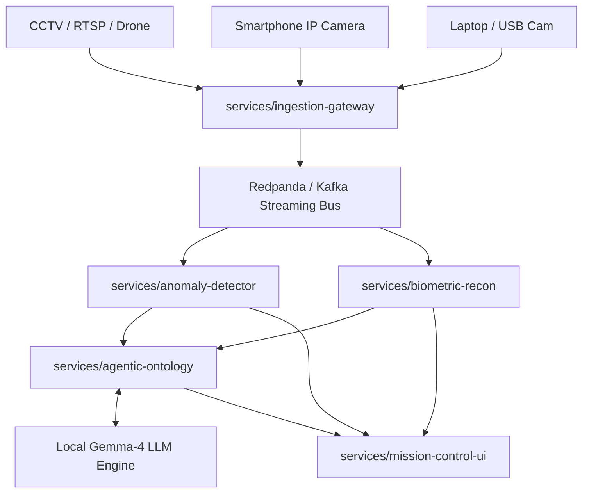

# Chronos Surveillance OS
### Next-Gen Autonomous Smart City Intelligence & Threat Reconnaissance Platform
*100% Pure Open-Source • Zero-AWS / Zero-Vendor-Lockin • Distributed Microservices Architecture*

---

## Overview

**Chronos Surveillance OS** is a distributed, cyber-tactical smart city surveillance platform. It ingests feeds from enterprise CCTV networks, mobile smartphones, and laptop webcams to execute real-time threat anomaly detection, 3D facial morphometry reconstruction, OSINT identity correlation, and multi-agent reasoning using local Large Language Models (LLMs).

<details>
<summary><b> Master System Architecture (Click to expand)</b></summary>


</details>

---

## Microservices Ecosystem

Every microservice in Chronos is self-contained with its own `pyproject.toml` (managed by `uv`), dedicated documentation, and architecture diagrams:

1. **[Ingestion Gateway](services/ingestion-gateway/)**: Universal feed ingestor for RTSP, smartphone IP cameras, and laptop webcams.
2. **[Anomaly Detector](services/anomaly-detector/)**: Spatial-temporal vision model detecting stampedes, abandoned objects, and perimeter breaches.
3. **[Biometric Recon](services/biometric-recon/)**: 468-point 3D facial mesh reconstruction (`.OBJ` export), vector search, and verified OSINT profiling without null values.
4. **[Agentic Ontology](services/agentic-ontology/)**: Multi-agent reasoning and city graph ontology powered by your local Gemma-4 LLM endpoint.
5. **[Mission Control UI](services/mission-control-ui/)**: Tactical HUD dashboard with target acquisition reticles, 3D biometric viewer, and Human-in-the-Loop (HITL) clearance controls.

---

## Quickstart

### Prerequisites
- [uv](https://docs.astral.sh/uv/) (`curl -LsSf https://astral.sh/uv/install.sh | sh` or `winget install astral-sh.uv`)
- [Docker & Docker Compose](https://www.docker.com/) (optional, for full-stack containerized deployment)
- Python 3.10+

### Option A: Launching with Docker Compose
```bash
# Start all microservices, Redpanda message bus, Qdrant vector DB, and MinIO storage:
docker compose up -d
```

### Option B: Local Development with `uv`
Run each microservice independently in separate terminal windows:

```bash
# 1. Start Ingestion Gateway (Port 8001)
cd services/ingestion-gateway && uv run python main.py

# 2. Start Anomaly Detector (Port 8004)
cd services/anomaly-detector && uv run python main.py

# 3. Start Biometric Recon & 3D Profiler (Port 8002)
cd services/biometric-recon && uv run python main.py

# 4. Start Agentic Threat Ontology (Port 8003)
cd services/agentic-ontology && uv run python main.py

# 5. Launch Tactical Mission Control HUD (Port 8501)
cd services/mission-control-ui && uv run streamlit run app.py
```

Open your browser at **`http://localhost:8501`** to access the tactical HUD.

---

## Documentation & Technical Manuals

- [System Architecture Overview](docs/architecture/system_overview.md)
- [Universal Camera Integration Guide (CCTV, Laptops, Phones)](docs/guides/camera_integration_guide.md)
- [Datasets & 3D Profiling Guide](docs/guides/datasets_and_training.md)
- [Ingestion Gateway Manual](services/ingestion-gateway/docs/guide.md)
- [Anomaly Detector Manual](services/anomaly-detector/docs/guide.md)
- [Biometric Recon Manual](services/biometric-recon/docs/guide.md)
- [Agentic Ontology Manual](services/agentic-ontology/docs/guide.md)
- [Mission Control UI Manual](services/mission-control-ui/docs/guide.md)

---

## License
This project is licensed under the Apache 2.0 / MIT License.
