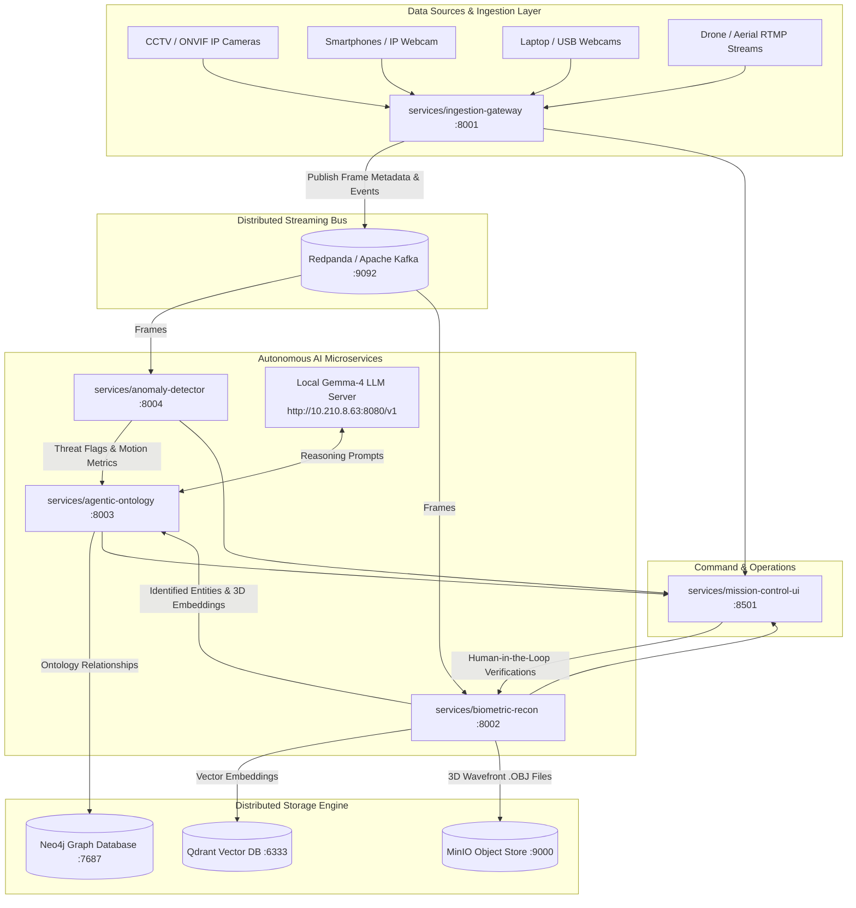

# Master Architecture - Chronos Surveillance OS

A 100% open-source, vendor-agnostic distributed surveillance intelligence operating system designed for city-scale deployments.

---

## 🏛 High-Level System Architecture

<b>📐 Distributed System Architecture Diagram (Click to expand)</b>

---

## 📂 Repository Microservices Matrix

| Microservice | Path | Port | Core Responsibilities |
| :--- | :--- | :--- | :--- |
| **Ingestion Gateway** | `services/ingestion-gateway` | `8001` | RTSP, RTMP, Phone, Laptop webcam ingestion, frame resizing & streaming. |
| **Anomaly Detector** | `services/anomaly-detector` | `8004` | Optical flow, MOG2 background subtraction, crowd anomaly and stampede detection. |
| **Biometric Recon** | `services/biometric-recon` | `8002` | MediaPipe 468-point 3D landmark mesh extraction, .OBJ generation, vector search, HITL queue. |
| **Agentic Ontology** | `services/agentic-ontology` | `8003` | Graph ontology (NetworkX/Neo4j), Gemma-4 local LLM reasoning and threat directives. |
| **Mission Control UI** | `services/mission-control-ui` | `8501` | Cyber-tactical HUD, live targeting reticles, 3D face mesh viewer, operator action console. |

---

## 🔒 Security & Privacy by Design
- **100% Local / Zero Cloud Dependency**: Operates entirely within your private network or on-premise hardware.
- **Human-in-the-Loop (HITL)**: Crucial identity matching actions require manual human operator confirmation before automated actions are triggered.
- **Data Integrity**: Profile enrichments never output unverified or raw `null` values; fallback indicators maintain operational clarity.
