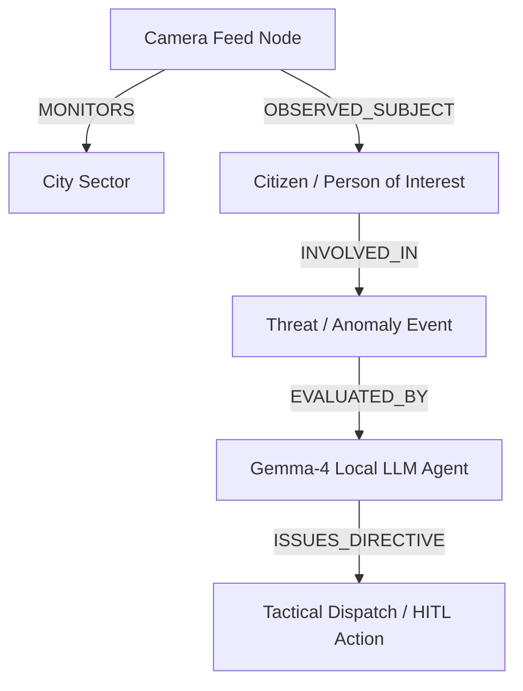

# Chronos Surveillance OS - Agentic Threat Ontology

Autonomous threat reasoning and multi-agent knowledge graph engine connected to your local Gemma-4 LLM server.

---

## 📌 Architecture & Ontology Relations

---

## 🚀 Quickstart Guide

### For Newbies
1. `cd services/agentic-ontology`
2. `uv sync`
3. `uv run python main.py`
4. Inspect graph schema at `http://localhost:8003/docs`
