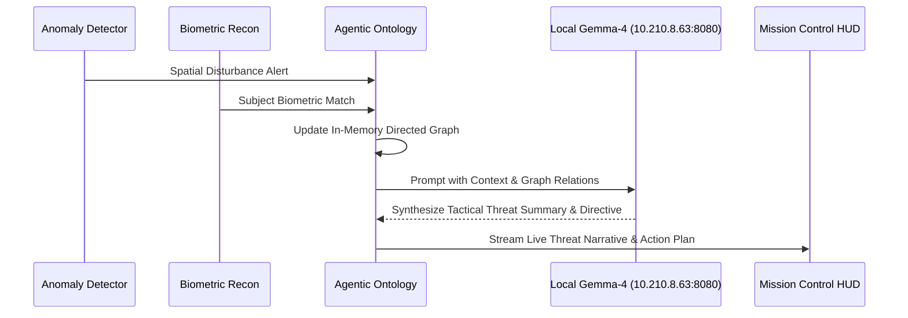

# Agentic Threat Ontology - Architecture & Graph Guide

<details>
<summary><b>🔍 Directory Structure (Click to expand)</b></summary>

```
services/agentic-ontology/
├── docs/
│   └── guide.md
├── main.py
├── pyproject.toml
└── README.md
```
</details>

<details>
<summary><b>📐 Multi-Agent Reasoning Loop (Click to expand)</b></summary>


</details>
