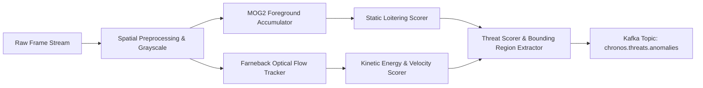

# Chronos Surveillance OS - Anomaly Detector

High-throughput, real-time spatial-temporal computer vision service detecting unattended luggage, sudden mob rushes, stampedes, and perimeter violations.

---

## 📌 Architecture & Logic



---

## 🚀 Quickstart Guide

### For Newbies
1. `cd services/anomaly-detector`
2. `uv sync`
3. `uv run python main.py`

### Testing Frame Analysis
```bash
curl -X POST http://localhost:8004/api/v1/anomaly/evaluate \
     -H "Content-Type: application/json" \
     -d '{"camera_id": "CAM_NODE_01", "image_base64": "<BASE64_IMAGE>", "timestamp": 1793695800}'
```
