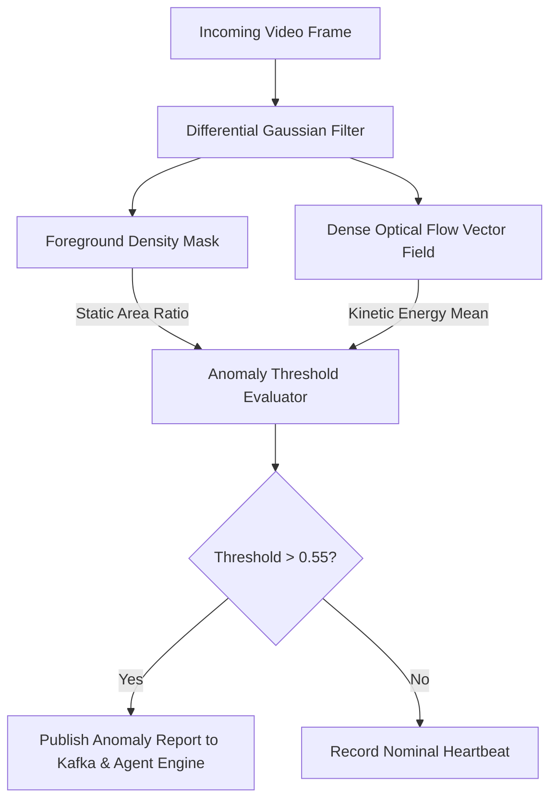

# Anomaly Detector - Developer & Operations Guide

<details>
<summary><b> Directory Structure (Click to expand)</b></summary>

```
services/anomaly-detector/
 docs/
 guide.md
 main.py
 pyproject.toml
 README.md
```
</details>

<details>
<summary><b> Algorithmic Scoring Flow (Click to expand)</b></summary>


</details>
