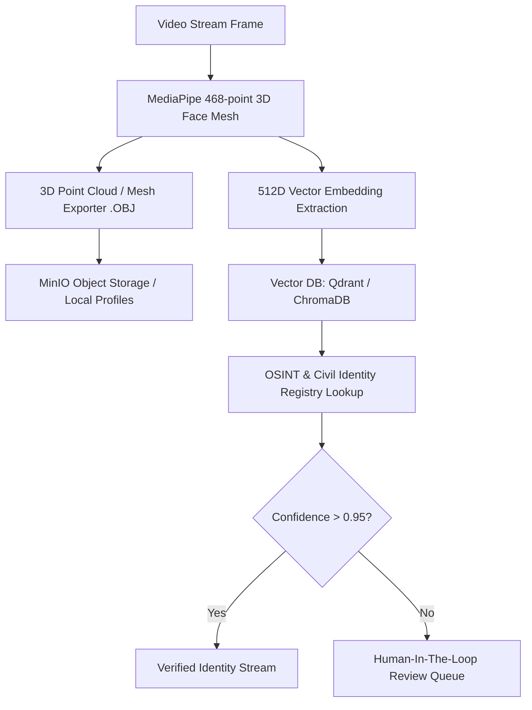

# Chronos Surveillance OS - Biometric Reconnaissance

3D facial morphometry reconstruction, vector-based identity matching, and Human-in-the-Loop (HITL) clearance system.

---

## 📌 Architecture & 3D Profiling Workflow

---

## 🚀 Quickstart Guide

### For Newbies
1. `cd services/biometric-recon`
2. `uv sync`
3. `uv run python main.py`
4. Access docs at `http://localhost:8002/docs`
