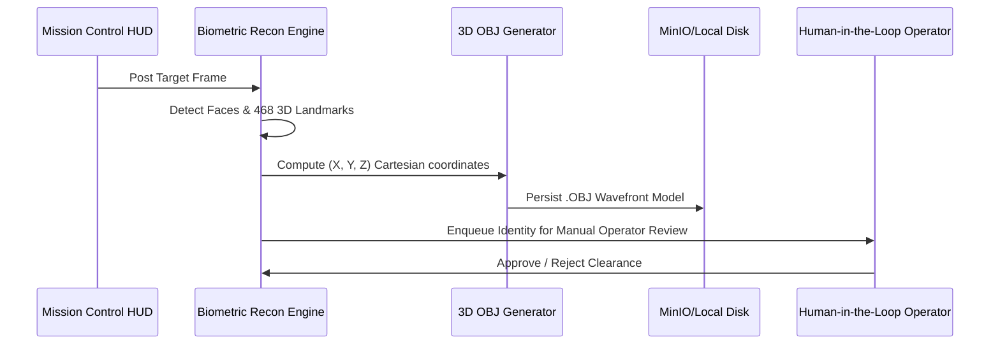

# Biometric Reconnaissance - Engineering & 3D Guide

<details>
<summary><b> Directory Structure (Click to expand)</b></summary>

```
services/biometric-recon/
 docs/
 guide.md
 main.py
 pyproject.toml
 README.md
```
</details>

<details>
<summary><b> 3D Biometric Morphometry & HITL Pipeline (Click to expand)</b></summary>


</details>
