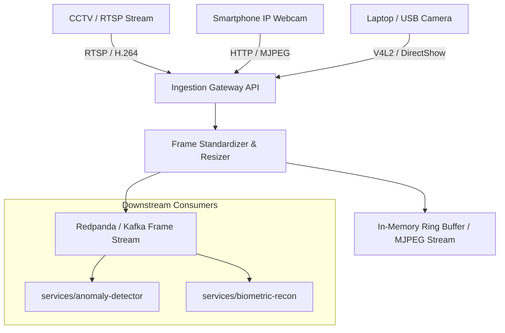

# Chronos Surveillance OS - Ingestion Gateway

Universal multi-camera video ingestion microservice designed for city-wide surveillance deployment.

---

## 📌 Architectural Overview



---

## 🚀 Quickstart Guide

### For Newbies
1. **Navigate to microservice:**
   ```bash
   cd services/ingestion-gateway
   ```
2. **Install dependencies using uv:**
   ```bash
   uv sync
   ```
3. **Run service:**
   ```bash
   uv run python main.py
   ```
4. Access interactive API documentation at: `http://localhost:8001/docs`

---

## 🛠 For Developers & DevOps
- Register phone camera:
  ```bash
  curl -X POST http://localhost:8001/api/v1/cameras/register \
       -H "Content-Type: application/json" \
       -d '{"camera_id": "PHONE_01", "source_url": "http://192.168.1.100:8080/video", "camera_type": "MOBILE_PHONE"}'
  ```
- Direct MJPEG live stream endpoint: `http://localhost:8001/api/v1/cameras/CAM_NODE_01/mjpeg`
