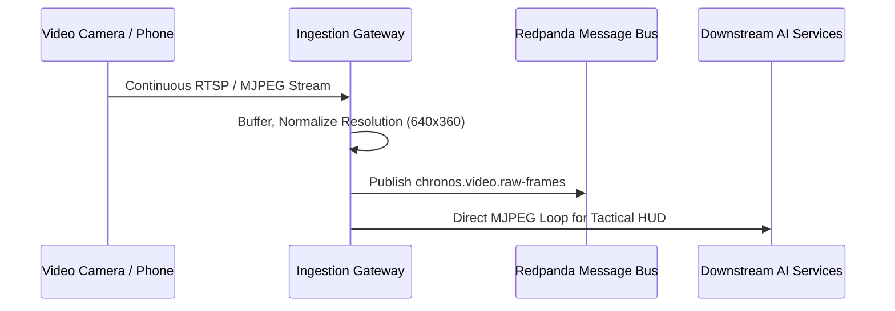

# Ingestion Gateway - Comprehensive Guide

<details>
<summary><b>🔍 Directory Tree Structure (Click to expand)</b></summary>

```
services/ingestion-gateway/
├── docs/
│   └── guide.md
├── main.py
├── pyproject.toml
└── README.md
```
</details>

<details>
<summary><b>📐 Stream Pipeline Architecture (Click to expand)</b></summary>


</details>

## 📱 Connecting Your Phone or Laptop
- **Android / iPhone**: Install **IP Webcam** or **DroidCam**, connect to your local Wi-Fi, and register the provided IP stream.
- **Laptop Webcam**: Use source index `0` or `1`.
