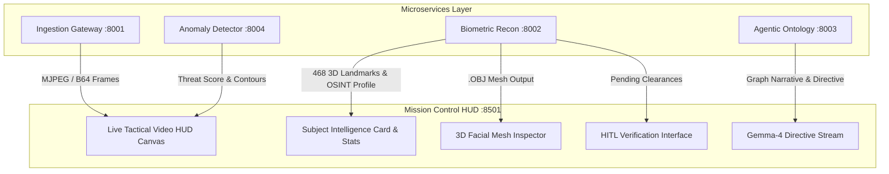

# Mission Control UI - Operator & Developer Manual

<details>
<summary><b>🔍 Directory Structure (Click to expand)</b></summary>

```
services/mission-control-ui/
├── docs/
│   └── guide.md
├── app.py
├── pyproject.toml
└── README.md
```
</details>

<details>
<summary><b>📐 Frontend Component & Data Flow (Click to expand)</b></summary>


</details>

## 🎮 Operator Controls
1. **Re-Scan Frame**: Triggers an instant snapshot analysis across all AI microservices.
2. **Force 3D Recon**: Generates and persists a 468-point 3D facial coordinate mesh `.OBJ` for the primary subject in view.
3. **Confirm Clearance Action**: Submits Human-in-the-Loop decision (`APPROVE_IDENTITY`, `FLAG_AS_ANOMALY`, or `REQUEST_HIGH_RES_SCAN`) and logs it in the ontology knowledge graph.
